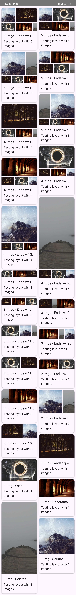

# Compose-Dynamic-Photo-Grid

🖼️ A dynamic, aspect-ratio-aware masonry image grid and note card layout built with Jetpack Compose.  
✨ Uses a smart modulo algorithm for clean and balanced row arrangements.

## Features

- 📐 Dynamic grid based on image count
- 🧠 Aspect-ratio-aware sizing
- 🧱 Masonry-style note cards
- 🔢 Smart modulo row arrangement
- 👀 Jetpack Compose preview cases

## Screenshots

<table width="100%">
  <tr>
    <th width="50%">Editor Image Grid</th>
    <th width="50%">Notes Staggered Grid</th>
  </tr>
  <tr>
    <td valign="top" width="50%">
      <a href="assets/editorExample.jpg">
        
      </a>
    </td>
    <td valign="top" width="50%">
      <a href="assets/gridExample.jpg">
        
      </a>
    </td>
  </tr>
</table>

## Project Structure

### `:photogrid` — reusable layout library
- 📐 `layout/PhotoRowArrangement.kt` — Pure Kotlin row rules (`arrangeRows`, `computeRowSize`), unit tested on the JVM
- 🧱 `ui/PhotoGrid.kt` — Generic Keep-style grid built from justified rows
- ↔️ `ui/JustifiedImageRow.kt` — Single-pass custom `Layout`: equal heights, widths by aspect ratio, height caps
- 🖼️ `ui/EditorImageGrid.kt` — Editor grid (rounded images, rows ≤ 65% of window height)
- 🗂️ `ui/NotePhotoGrid.kt` — Card grid (newest 6 images, tall rows capped)
- 📦 `model/PhotoGridImage.kt` — Image model (any Coil model + aspect ratio)

### `:app` — sample app
- 🚀 `ui/DemoApp.kt` — Notes board and editor permutation tabs; tap a note to open it
- 🗒️ `ui/notes/` — `NotesStaggeredGrid`, `NoteCard`, responsive `NoteGridCells`
- ✏️ `ui/editor/` — `NoteEditorScreen`, `EditorGalleryScreen` (centered 600dp column on wide screens)
- 🧪 `sample/SampleData.kt` — Sample gallery and permutations shared by the app and previews
- 👁️ `ui/previews/` — Phone and tablet previews

## Responsive Behaviour

| Window | Board columns |
| --- | --- |
| Phone portrait (~411dp) | 2 |
| Phone landscape / tablet portrait (~800–914dp) | 3 |
| Tablet landscape (1280dp) | 5 |

## Tests

```bash
./gradlew testDebugUnitTest            # JVM: row arrangement, row sizing, column count
./gradlew connectedDebugAndroidTest    # Compose UI: layout bounds at 360–1280dp, cards, navigation
```

## Tech Stack

- 💜 Kotlin
- 🎨 Jetpack Compose
- 🌀 Coil 3
